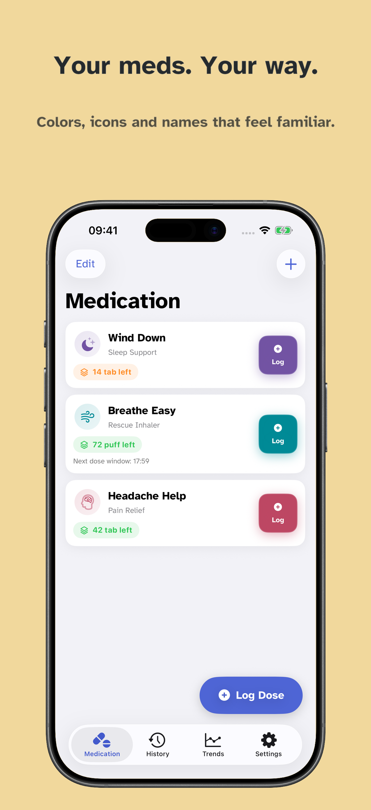

# AsNeeded

[](https://swift.org)
[](https://developer.apple.com/ios/)
[](LICENSE.txt)

[](https://github.com/dan-hart/AsNeeded/actions/workflows/build.yml)
[](https://github.com/dan-hart/AsNeeded/actions/workflows/drift.yml)
[](https://github.com/dan-hart/AsNeeded/actions/workflows/security-scan.yml)


AsNeeded is a free, open source iOS and watchOS app for tracking as-needed medications. Record doses, review History and Trends, and keep track of stock and reminders. Records stay in local storage, with optional export and backup. Tips and subscriptions support development.

**[Download As Needed on the App Store](https://apps.apple.com/us/app/as-needed/id6714469235)**

<a href="https://apps.apple.com/us/app/as-needed/id6714469235"></a>

*AsNeeded 1.2.0 with fictional medication data.*

Dose guidance uses the settings and doses you record. Follow your prescription and care team’s instructions. See [privacy](PRIVACY.md), [security](SECURITY.md), and the [medical disclaimer](DISCLAIMER.md).

## Build from a clean checkout

Use a supported Xcode installation with an iOS 26 or later simulator runtime.

```bash
git clone https://github.com/dan-hart/AsNeeded.git
cd AsNeeded
git switch task/v1.3.0
./scripts/install-hooks.sh
python3 scripts/doctor.py
./scripts/dev-build.sh
```

Open `AsNeeded.xcodeproj`, choose the AsNeeded scheme and a simulator, then run from Xcode. Use [the contributor guide](CONTRIBUTING.md) for setup details, test commands, and device signing.

## Start here

- [Development docs and repository map](docs/README.md)
- [Business rules and regression evidence](BUSINESS_RULES.md)
- [Architecture and data ownership](docs/architecture.md)
- [Design and App Store assets](Design/README.md)

AsNeeded is licensed under [GPL-3.0](LICENSE.txt).
