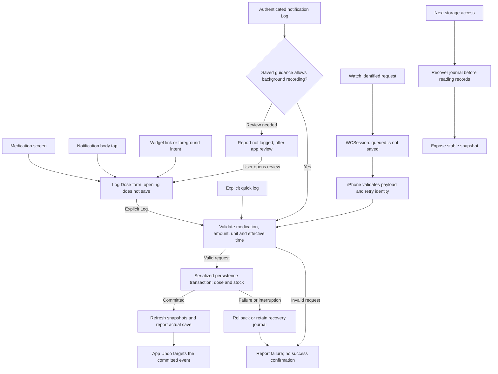

# Architecture and source ownership

AsNeeded is a native SwiftUI iOS app, iOS widget extension, and independent watchOS app. The Xcode project also configures the Swift Testing unit-test target. Most source membership uses file-system synchronized groups; an empty explicit Sources list does not mean a target has no code.

## Boundaries

| Area | Responsibility |
| --- | --- |
| `AsNeeded/Features/` and `AsNeeded/Views/Components/` | SwiftUI screens, reusable components, and UI state owners |
| `AsNeeded/Shared/` | Target-neutral stored and wire identifiers compiled into app, widget, and Watch |
| `AsNeeded/Services/` | Deterministic guidance/projections, notifications, purchase integration, search, and external-effect adapters |
| `AsNeeded/Services/Persistence/` | App Group storage, migration, recovery, import/export, and serialized dose/stock transactions |
| `AsNeededWidget/` | Timeline snapshots, configuration, projections, and medication-specific navigation |
| `WristAsNeeded Watch App/` | Watch presentation, local message DTOs, and WCSession transport |
| `AsNeededTests/` | Domain/service/view-model regressions with injected storage, time, and external clients |
| Remote Swift packages | ANModelKit records, Boutique persistence, RxNorm lookup, logging, symbols, colors, and purchase SDKs; exact resolved revisions are in `Package.resolved` |

ANModelKit contains medication, dose, event, and unit records. Calculations belong in testable services; UI state owners compose them with persistence and presentation. Keep state ownership and the surrounding Observation/ObservableObject pattern consistent when making a narrow change.

## Recording and recovery

The app's `DataStore` uses `MedicationPersistenceTransactions` to coordinate medication, event, stock, and preference updates. Await recovery/loading before deriving availability or acting on a snapshot. A failed or canceled operation must not be treated as a committed dose. Shared app/widget access is a cross-process storage boundary, not merely a main-actor concern.

At iOS startup, the app presents a read-only preview of the saved tab while the migration coordinator prepares storage. The preview uses static placeholders. The live tab roots and their data tasks start after the coordinator reports completion. An unsuccessful startup presents the recovery screen and retry action.

The Watch app does not open the phone's Boutique databases. It sends identified requests through WCSession; the iPhone validates and persists them. Queued transport and completed recording are distinct outcomes.

Notification action handling and widget intents are platform-discovered entry points. A lack of direct Swift callers is not grounds for removing their identity. Background Log actions use the recording policy and an idempotent event identity; paths needing review navigate to the medication form instead. Home Screen widgets favor navigation to app review.

## Changes and verification

Read [business rules](../BUSINESS_RULES.md), [storage safety](DATA_STORAGE_GUIDELINES.md), and the relevant [rule module](../ai-rules/rule-loading.md) before changing an ownership or persistence boundary. Prefer small reversible changes with an observed regression or a concrete new requirement. Do not introduce a broad architecture, dependency, storage, or observation migration as routine cleanup.

Build the app scheme after project/shared-source changes; it includes the iOS widget and Watch dependencies. Run relevant tests and check the actual Xcode result bundle. CI, simulator, and physical-device evidence prove different things. See [scripts](../scripts/README.md) and [Drift](drift.md).

## Feature folders

Screen-specific SwiftUI views, UI state, and view models live together under `AsNeeded/Features/<Feature>/`. Medication includes its History/Trends screens and date-range view models; Settings includes backup/data-management view models. Main holds top-level tab wrappers, while Support, Onboarding, and Disclaimers have their own folders. Cross-feature components stay in `Views/Components/`; domain/app values stay in `Models/`; shared effects and persistence stay in `Services/`.

This is source organization, not a module, navigation, dependency-container, or state-ownership migration. App source membership still comes from the synchronized `AsNeeded` root. The source moves preserve file contents. New shared contracts have explicit widget/Watch membership; they do not give Watch a database handle or entitlement.

## Recording flow

The diagram shows ownership and outcomes, not identical UI for every entry point. Notification policy assessment is serialized with recording; it must not rely on an earlier stale snapshot. An app form can explain guidance without preventing basic record-keeping. Background notification feedback does not promise an app toast or Undo action. Watch transport acknowledgement does not prove a dose was saved. See [stable rule IDs](../BUSINESS_RULES.md#rule-traceability) for implementation and regression references.
