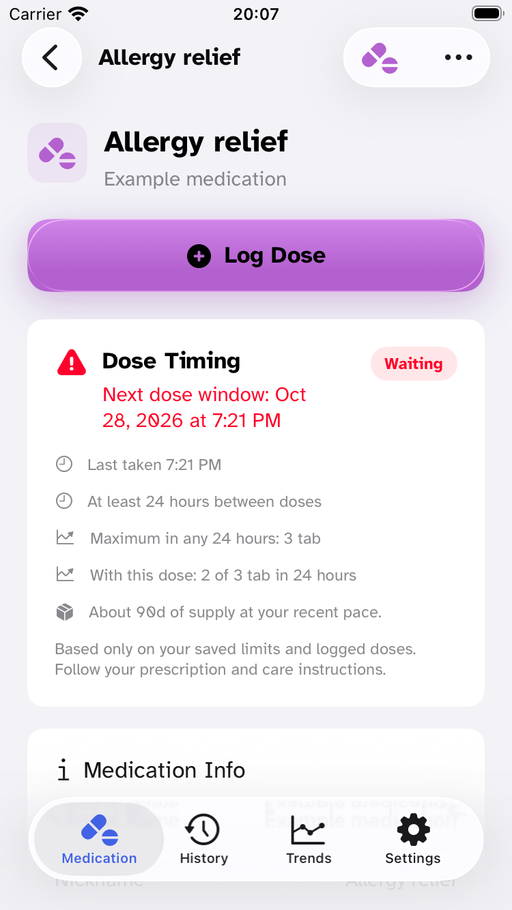
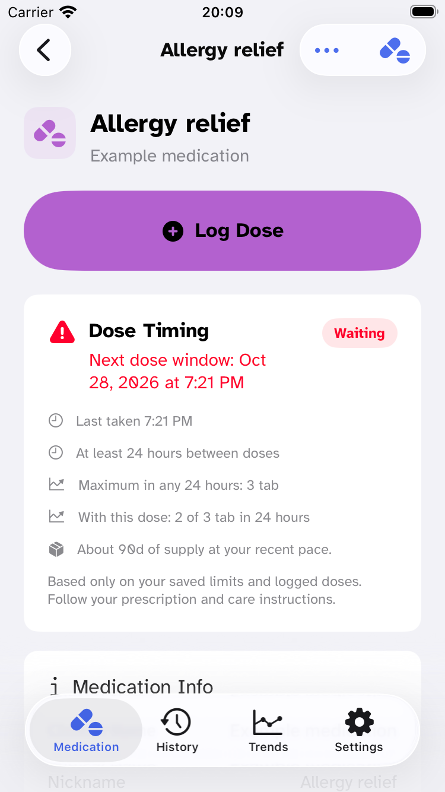

# 1.2.0 Liquid Glass and toolbar audit

October 27, 2026. Scope: native SwiftUI toolbar treatment and the distinction between system navigation glass and content surfaces. No medication calculations, storage, notification scheduling, Watch transport or release settings changed.

## Findings and changes

| Finding | Applied change |
| --- | --- |
| Toolbar icons used custom font sizes/weights, gray foreground overrides and extra circular checkmark artwork. | System-sized symbol labels, plain checkmarks and accent tint at toolbar hosts; descriptive accessibility labels and existing callbacks retained. Text buttons retain the selected app font at ordinary body style. |
| The detail More menu used `.secondaryAction`, so iOS put a custom menu inside its own overflow menu. | Visible native trailing `Menu`, plain ellipsis and accent tint. Edit/History/Delete now open directly. Destructive roles remain. |
| List controls were grouped in a custom HStack inside one toolbar item. | Native `ToolbarItemGroup` lets iOS lay out and group the controls. |
| Appearance editor repeated Save in the toolbar and bottom action area. | One existing sticky Save remains; the native close action remains in its toolbar. |
| Detail Log Dose combined gradient fill, custom glass and shadow. | Native prominent button style with medication color in content. Toolbar actions use the app accent. |
| Shared form cards imitated the controls layer with material, highlight borders and shadows. | The existing `.glassCard()` helper now renders an opaque adaptive system content surface. Removed obsolete shadow parameters from this internal helper and updated its preview. Other regular SwiftUI material footers remain purposeful floating action surfaces; ordinary materials are not the Liquid Glass API. |
| Repo guidance recommended adding glass broadly and contained incorrect/unverified API examples. | Replaced `docs/LIQUID_GLASS.md` and the local SwiftUI expert Liquid Glass reference with concise native-first guidance and primary-source links. |

No custom `.glassEffect` calls remain in app source. Standard controls still receive Liquid Glass from iOS. This is intentional: system toolbars manage their own material, grouping and display-setting behavior. We do not add another glass container to system toolbar content. Native back/close/destructive roles may retain the system's neutral or destructive treatment; custom action colors no longer override toolbar tint.

## Skill and primary sources

Reviewed the focused [Dimillian SwiftUI Liquid Glass skill](https://github.com/Dimillian/Skills/tree/main/swiftui-liquid-glass), the broader [SohrabZ skill collection](https://github.com/SohrabZ/liquid-glass-skills), and the already-vendored SwiftUI Expert reference. Selected Dimillian as the best fit among these for reviewing an existing native SwiftUI feature. Applied its review workflow, not every illustrative snippet. No global skill installer or external script was executed.

Apple's [Adopting Liquid Glass](https://developer.apple.com/documentation/technologyoverviews/adopting-liquid-glass) is the authority: standard components supply the design, custom backgrounds can interfere, related toolbar actions use native grouping, and custom effects need restraint. [Applying Liquid Glass to custom views](https://developer.apple.com/documentation/SwiftUI/Applying-Liquid-Glass-to-custom-views) supplies the custom API details. Optional skill references remain outside builds/CI.

## Verification

- Build: `xcodebuild -project AsNeeded.xcodeproj -scheme AsNeeded -destination 'platform=iOS Simulator,id=146F52BA-7FD9-464E-9374-923ED84EECD1' -configuration Debug -parallelizeTargets build` — **BUILD SUCCEEDED**. Log `/tmp/asneeded-glass-audit/build.log`. The optimized dev script pins unavailable iOS26.1; installed iOS26.5 was used instead.
- Focused typography/contrast checks: **44 tests in 2 suites pass**, `TEST EXECUTE SUCCEEDED`, using `xcodebuild test-without-building` with project/scheme `AsNeeded`, serial testing, destination `EF1D8544-7F1F-4EA8-9EBC-C7ABA9E371D9` and `-only-testing:AsNeededTests/FontFamilyTests -only-testing:AsNeededTests/ColorContrastTests`. Log `/tmp/asneeded-glass-audit/verified-checks.log`; result `/tmp/asneeded-glass-audit/verified-checks.xcresult`. The initial test command built the final internal card-API cleanup but its test launch stalled before reporting any tests; it was interrupted and only its dedicated test simulator was restarted. This is not counted as a passing run.
- Source: changed-file Swift parsing and `git diff --check` pass. Inspected toolbar item/group declarations and implicit toolbar hosts across app source. No test target or tests mirroring presentation strings/styles were added.
- iPhone SE3, iOS26.5, `146F52BA-7FD9-464E-9374-923ED84EECD1`: rendered list, detail, editor and date-confirmation toolbars at standard text in light appearance; detail at Atkinson AX5, dark appearance and Increase Contrast. More opens Edit/View History/Delete directly; Edit opens the existing form; close returns without saving. The date picker is a scrollable native graphical picker in its existing sheet.
- iPad Pro13-inch M5, iOS26.5, `E9148ED3-6295-406B-BD41-9C03F2F975B5`: final compiled Add Medication sheet inspected; accent close button, opaque content sections and existing Save action.
- Builds/screenshots are local Debug1.2.0(308) with this source diff, not the distributed TestFlight308 artifact. Synthetic medications only. No physical device or TestFlight change in this pass.
- Still manual: actual Reduce Transparency/Reduce Motion settings, hands-on VoiceOver/Voice Control/Full Keyboard Access, every sheet/device/rotation, physical rendering and performance profiling. Computed contrast tests do not certify every rendered composite surface.

## Screenshots

| Before detail | After detail |
| --- | --- |
|  |  |

[Additional inspected captures](evidence/1.2.0-liquid-glass/) include the editor, native date confirmation, dark/AX5/Increase Contrast detail, and iPad form.
