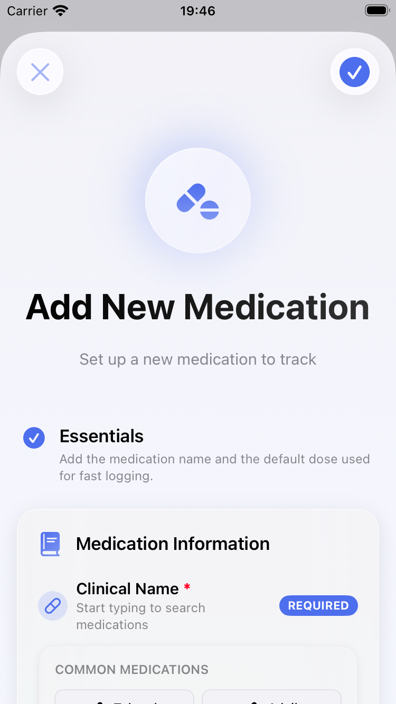
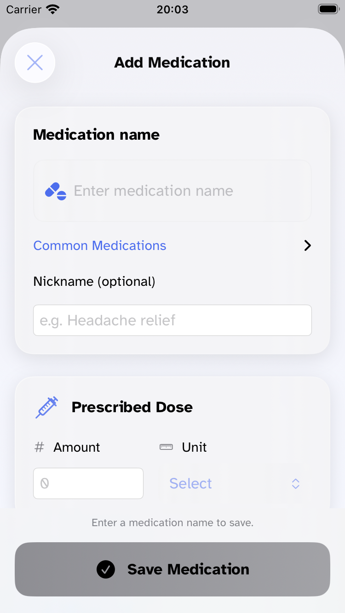

# 1.2.0 UX and accessibility audit

Historical scope note (October 28, 2026): Live Activities were subsequently removed during stabilization. References and source inventory below describe the earlier audit; they do not advertise current Live Activity support. Only app-launch retirement cleanup remains to end activities created by earlier builds.

Status: source audit and implementation pass completed October 27, 2026. Final focused verification: **255 tests in 20 suites pass**, plus **3 Watch availability harness tests**. The inventory covers **87 files and 129 interface declarations**, including helpers and previews; it is not a claim that 129 screens were rendered. Manual assistive-technology and physical-device checks remain below.

## Scope and design criteria

The request is to make the entire app easier to understand and use: clear medication names, amounts and units; an obvious log action; simpler language; calm native controls; accessible text, interaction and feedback. The audit includes the iPhone app, its shared components and settings, Watch, widgets, Live Activities, and Shortcut result views. Existing font families, optional medication fields, medical disclaimers and dose calculations are preserved.

The design references are Apple's [Accessibility](https://developer.apple.com/design/human-interface-guidelines/accessibility), [Writing](https://developer.apple.com/design/human-interface-guidelines/writing), [Layout](https://developer.apple.com/design/human-interface-guidelines/layout), and [Typography](https://developer.apple.com/design/human-interface-guidelines/typography) guidance. These inform named controls, clear action/result wording, adaptable layouts and semantic text. This is a usability audit, not certification of HIG or WCAG conformance.

The work uses the existing SwiftUI app architecture, adaptive colors, accent treatment and accessible font choices. No new UI/snapshot testing target, visual identity replacement, release upload, or physical-phone modification is part of this pass. Existing untracked App Store artwork is outside the change.

## Evidence boundaries

- **Source review:** the per-file declaration inventory below covers all app, Watch, widget and intent SwiftUI declarations, including small wrappers, embedded helpers, modifiers, representables, preview wrappers and unused legacy components. A source finding establishes the implementation, not its exact appearance or VoiceOver behavior.
- **Behavior verification:** focused Swift Testing suites and the Watch model harness exercise their selected domains. They do not establish physical notification delivery, WatchConnectivity reliability or the full repository test suite.
- **Rendered evidence:** the coordinator used a separate iPhone SE (3rd generation) simulator, iOS 26.5, UDID `146F52BA` prefix, with synthetic data. Before captures include Welcome, Medication list and Add Medication. After captures include Add Medication, Log Dose, Medication Detail, Medication list and Trends; History was viewed in light/dark appearance. A Watch SE (3rd generation) unavailable-phone state was viewed. The final iPad 13-inch M5 medication sheet was also rebuilt and inspected. Full simulator identities and final evidence are below.
- **Interaction evidence:** coordinator observation confirms a short tap opens the dose form; a long press creates one event; Undo changed the synthetic history count from 11 to 10. This verifies those observed interactions, not every error path or physical device.
- **Accessibility evidence:** accessibility-size-five rendering exposed double-scaling of custom fonts. The shared-font correction and a font regression test are now in the diff. The final resolved-font regression passes against explicit UIKit font metrics; rebuilt AX5 entry, Settings and Undo were inspected. An accessibility tree alone does not establish reading order, announcements, focus restoration, keyboard access, spacing or contrast.

## Implemented findings

| Priority | Verified issue and impact | Change in current diff | Evidence and remaining check |
| --- | --- | --- | --- |
| P1 | Quick-log feedback used the pre-log next date, which could show an earlier window after a new dose. | `QuickLogFeedbackService` requires a supplied post-save `nextDoseDate`, retains that date in feedback, and formats the next window from it. Warning tone/detail still describe the pre-log assessment. The list view model supplies post-save availability. | Service regression covers pre-log +2 hours versus supplied +4 hours, nil/elapsed dates; view-model regression compares the stored event/date and saved interval. Included in the focused pass. |
| P1 | Medium backgrounds could receive white text below 4.5:1 despite black passing. | `Color+Contrast` resolves the requested appearance and chooses the higher computed black/white WCAG contrast ratio. | Actual RED run: 9 tests, 21 issues. The GREEN contrast suite and focused run passed. Independent opaque-color tests cover representative medium colors, every current medication palette entry and a dynamic background in both appearances. This does not measure rendered/translucent UI contrast. |
| P1 | Watch quantity cancellation changed visible stock; queued requests and receipt acknowledgements could look saved. | Quantity editing keeps a local draft until confirmation; sender distinguishes saved/queued/unconfirmed; receiver replies after persistence and rejects invalid numeric payloads. | Payload validation tests and three Watch model tests pass. Physical delivery, duplicate/correlation behavior and partial-save paths remain open. |
| P1 | History errors could lose the editor/draft, remove an entry before replacement, or restore stale stock during bulk changes. | Mutation results/errors, draft retention, discard confirmation and serialization make failure visible. Updates now replace the same ID without a prior removal; edit deltas use the stored event; each stock change rereads current medication state. | Final same-ID/repeated-edit and bulk stock-restoration regressions pass in the 255-test integrated run. Multi-store partial-write risks remain separately tracked below. |
| P2 | Important timing and names were clipped or repeated; gesture-only quick log was hard to discover. | Core forms/detail/list use clearer saved-limit wording, wrapping critical text, semantic log controls, named actions and restrained repeated copy. The medication input centers on name/search and optional nickname; medication-list support suggestion is removed; Save scrolls with the editor at accessibility sizes. Optional fields and units remain. | Focused medication suites passed before final font/entry refinements; small-screen Add/Log/Detail and tap/long-press/Undo observed. Final large-size layouts, localization and assistive operation remain checks. |
| P2 | Settings switches, backup picker and icon controls lacked meaningful names. | Named toggles/pickers/info/close/delete controls; text Export/Cancel; selected font traits; independent provider links; destructive restore role. | Syntax/build coverage through coordinator; VoiceOver action/focus behavior remains manual. |
| P2 | Settings placed donations before controls; technical wording increased scanning effort. | Preferences and Data come first; plain descriptions replace internal review terminology; long import settings choices use a menu with unchanged tags. | Source review; final settings render/navigation check remains. |
| P2 | Welcome, migration errors and restore content could bury actions at large sizes. | Sticky Continue preserves the full medical notice; migration/restore content scrolls; font choices apply to previously inconsistent destinations. | Small Welcome baseline and source review; final large-text recovery/restore/Welcome checks remain. |
| P2 | Dismissing a share sheet always announced successful export/send. | Feedback now says an export/log file was prepared, without claiming the user saved or sent it. | All share/clear/import sequencing remains unchanged. Cancel/save/share must still be distinguished in runtime checks. |
| P2 | Date and note cards nested independent actions in one button. | Expand/edit/remove are sibling controls with meaningful names and comfortable targets; changed-note discard and a single Save action are clear. | Source/build review. Real VoiceOver and keyboard operation remain manual. |
| P2 | Search, selectors and continuous decoration increased effort or motion. | Search keeps entry first, collapses common choices, names/sizes Clear and guards stale responses; color/symbol selections expose state; useful no-results actions; perpetual Add Note pulse removed; touched motion respects Reduce Motion. | Source review. No deterministic async-search race/failure-injection test was added. |
| P2 | Trends/history dense grids and controls were crowded at large text sizes. | Adaptive controls/metrics, named calendar controls, accessibility daily-list alternative, complete summary labels, separate entry/note actions and actionable empty states. | Focused view-model suites passed; Trends small-screen capture exists. Calendar VoiceOver traversal and all size variants remain manual. |
| P2 | Scheduled reminders mixed with next-dose terminology; selected days/types were not exposed; date/delete controls were unnamed. | Clear scheduled-reminder copy, native date-picker names, selected traits, adaptive weekday/type layouts, wrapping row text, 44-point delete targets and Reduce Motion. Denial retains the form/Settings path; authorized/provisional/ephemeral statuses are accepted. | Date/recurrence and load/delete function bodies were source-compared unchanged. Permission-state transition scenarios and actual scheduling remain runtime checks. |
| P2 | Widgets, Watch and Shortcut language could overstate readiness/refill certainty or conceal missing data. | More explicit saved-limit/no-history wording; medication/dose-specific widget actions separate from navigation; native relative timing in primary widget layouts; Live Activity identity; fractional usage/stock preserved; clearer logged outcomes. | Focused status/Shortcut/availability tests pass. Widget extension rendering and Siri spoken output are not claimed. |
| P2 | Support screens obscured optionality and purchase state. | Optional support is explained first, localized loaded product prices are used, accessibility layouts/fonts and Done actions improve clarity, touched celebration respects Reduce Motion. | Source/build review only; no purchase or subscription action was performed for this audit. |
| P2 | Custom fonts were scaled by UIKit's current category and again by SwiftUI. | `Font+CustomFonts` starts at the standard `.large` UIKit size, then lets SwiftUI apply relative scaling. Toast content uses a fitting/scrollable layout with persistent Dismiss/Undo. | Found in actual AX5 rendering. Final font suite passes (35 tests), including both custom families at standard and AX5 sizes against an independent UIFontMetrics oracle. Final Atkinson AX5 entry, Settings and Undo screenshots were inspected. |

## Remaining issues and explicit limits

1. **P1 — Event and stock writes are not one transaction.** `MedicationListViewModel` performs separate event/medication writes; `WCReceiver` writes an event before reducing stock; the widget intent also persists event and quantity separately. A later failure can leave a recorded dose with unchanged stock, or a quantity change without the expected event. History edits/deletes similarly span records. Cautious error wording reduces blind retries, but does not make these writes atomic. A focused persistence/recovery design with failure injection, idempotency and rollback/reconciliation is required; this audit does not claim to fix that storage behavior. The history remove-before-insert and stale-stock subcases have been corrected in the diff; their final integrated regressions pass.
2. **P2 — Physical Watch delivery/correlation remains unverified.** A queued transfer is visibly pending rather than saved. Test on a paired physical Watch/iPhone with reachable/unreachable transitions, reconnection, delayed confirmations and repeated actions; verify one intended dose/event and stock result. The model harness does not exercise this transport.
3. **P2 — Assistive operation remains manual.** Operate VoiceOver and Full Keyboard Access through add/edit/log, long-name search, note controls, scheduled reminders, export/restore and Undo. Verify reading/focus order, selected traits, announcements, action reachability and focus after dismissal/error. No automated tree dump substitutes for these checks.
4. **P2 — Large-text coverage remains sampled.** Atkinson AX5 entry, Settings and Undo were rebuilt and inspected; both custom fonts pass resolved-size tests. OpenDyslexic full-screen layouts, recovery/restore states and every device/text-size combination remain manual checks.
5. **P2 — Widgets/Live Activities require surface evidence.** Validate small/medium/large/accessory families, long names, tint/lock-screen treatment, missing/loading data, expired timelines and background/terminated app behavior. No physical widget or Live Activity delivery/rendering claim is made.
6. **P2 — Contrast coverage is limited to computed opaque colors.** Materials, opacity, secondary text, gradients, increased contrast and actual light/dark compositions still require measurement/inspection. The helper's secondary-opacity API does not promise AA for every composite surface.
7. **P2 — Recovery and asynchronous failures need further scenarios.** Exercise permission denial/re-enabling, cancelled export, partial import/restore failures, stale search completions, missing widget data and genuine disk failures without accessing personal medication data. Existing broader-suite legacy fixture/import limitations are documented in `1.2.0-dose-timing-verification.md`; they are not represented as passing here.
8. **P3 — Rotation and localization breadth is incomplete.** The final iPad 13-inch medication sheet was inspected, but this does not establish every iPad destination, rotation, keyboard coverage or translated-label fit. Preserve state while resizing and verify long names/units in the remaining layouts.

## Verification record

- **Final integrated result:** `xcodebuild test-without-building` on project/scheme `AsNeeded`, destination `platform=iOS Simulator,id=EF1D8544-7F1F-4EA8-9EBC-C7ABA9E371D9`, `-parallel-testing-enabled NO`, with the 20 explicit suites below: **255 tests pass**, `TEST EXECUTE SUCCEEDED`. Log `/tmp/asneeded-ux-audit/verified-focused.log`; result `/tmp/asneeded-ux-audit/verified-focused.xcresult`.
- The final compiled app/test bundle came from `xcodebuild test` with the same project/scheme/destination and `-only-testing:AsNeededTests/FontFamilyTests`: **35 pass**, `TEST SUCCEEDED`. Log `/tmp/asneeded-ux-audit/font-metrics.log`. The app, widget extension and Watch dependencies build in this target graph with Xcode 27.2 Release Candidate. No archive/upload was performed.
- Suites: ColorContrastTests, WatchMessageValidationTests, MedicationHistoryViewModelTests, MedicationListViewModelUnitTests, MedicationDetailViewModelTests, MedicationEditViewModelTests, MedicationTrendsViewModelTests, MedicationStatusSummaryServiceTests, QuickLogFeedbackServiceTests, MedicationAvailabilityTests, MedicationDoseLimitMigrationTests, MedicationAvailabilityNotificationPlannerTests, DoseAvailabilitySurfaceRegressionTests, LogMedicationIntentTests, GetDailyUsageIntentTests, GetNextDoseIntentTests, CheckRefillStatusIntentTests, ListMedicationsIntentTests, FontFamilyTests and FontManagerTests. Reproduce with one `-only-testing:AsNeededTests/<suite>` argument per suite.
- **Watch harness:** `scripts/tests/watch-medication-availability.test.sh`: 3 pass; `/tmp/asneeded-ux-audit/watch-harness.log`.
- **Meaningful regressions:** maximum opaque foreground contrast, custom-font single scaling under ambient AX5, post-log next window and date across midnight, one-event Undo identity, missing/repeated History mutations, same-medication multi-delete stock restoration, same-ID repeated edits, invalid Watch payload rejection. These do not establish real disk/transport failure recovery.
- **Earlier verification:** the original focused run passed 251/20. Contrast test-first RED produced 21 issues in 9 tests; its GREEN is the focused run, not the failed `contrast-green.log` compile attempt. One final attempt hit a compile declaration error (fixed); another app launch failed to load the test bundle and was interrupted/restarted. A font test initially compared custom and system font metrics incorrectly; its independent explicit UIFontMetrics oracle now passes without changing tolerance. No failed/interrupted attempt is counted as passing.
- `git diff --check` and changed-file syntax checks pass. The full repository suite is not claimed green; pre-existing fixture/import issues are documented in `1.2.0-dose-timing-verification.md`.

### Rendered and interaction evidence

| Surface | Configuration | Observed result |
| --- | --- | --- |
| iPhone SE (3rd generation), iOS 26.5 | `146F52BA-7FD9-464E-9374-923ED84EECD1`, 375×667 points; final Debug 1.2.0 (308) source with UX changes | Standard entry, Log Dose, detail, History light/dark, Trends and Settings sampled. Final entry at Atkinson AX5 has full-width search; amount/unit stack; Save scrolls with the form. |
| Quick logging on that simulator | Synthetic medication/events only | Short tap opens form; long press adds one event; Undo removes it (11→10 events). Drag starting on Log creates no event (count stays10). At AX5, Dismiss/Undo remain visible; tapping Undo returns count to10. Message area scrolls independently. |
| Changed medication draft | Standard size, synthetic unsaved nickname | Close shows explicit discard confirmation; Discard Changes dismisses the sheet. No medication was added. Full assistive focus/draft-retention traversal remains manual. |
| iPad Pro 13-inch (M5), iOS 26.5 | `E9148ED3-6295-406B-BD41-9C03F2F975B5`, final compiled app | Welcome/Continue and empty state inspected; final Add Medication sheet rendered with readable name/dose controls. Other destinations and rotation not exhaustively rendered. |
| Watch SE3 40mm, watchOS26.5 | `187FC903-6848-4DD2-9055-F3AD6A705CAE` | Built app installed/launched; unavailable-phone message and Refresh inspected. Unpaired simulator does not establish paired delivery. |

Durable, synthetic-only screenshots: [evidence folder](evidence/1.2.0-ux/). The baseline is an earlier build; final screenshots show this audit's changes. App Store artwork was preserved separately and predates this pass. Standard iPhone entry comparison:

| Before | After |
| --- | --- |
|  |  |

Additional captures include Atkinson AX5 entry/Settings/Undo, final iPad entry, and the Watch unavailable state. Temporary wider evidence remains under `/tmp/asneeded-ux-audit`. Reduce Motion was reviewed in touched source paths; no full runtime motion/VoiceOver/Full Keyboard Access certification is claimed.

## Per-file declaration coverage

Inventory covers source declarations, not 128 independently rendered screens. `ViewModifier`, representable, Widget/AppIntent and preview declarations are labeled explicitly. The following routes/roles were reviewed across the coordinator and domain owners. Runtime coverage is restricted to the named samples above. Unchanged helpers are included so absence from the diff cannot be confused with omission from the inventory.

Paths are relative to the repository root. Inventory: **87 files, 128 declarations**, including three ButtonStyle helpers. Supporting non-view models/services are listed after the table.

| Source file | Declarations | Role / reachability |
| --- | --- | --- |
| [AsNeeded/Extensions/Font+CustomFonts.swift](../../AsNeeded/Extensions/Font+CustomFonts.swift) | `CustomFontModifier` (ViewModifier); `CustomNavigationTitleModifier` (ViewModifier) | Shared font/navigation modifiers; selected families and semantic sizes; final font regression and sampled Atkinson AX5 rendering pass. |
| [AsNeeded/Extensions/View+DynamicDetent.swift](../../AsNeeded/Extensions/View+DynamicDetent.swift) | `DynamicDetentModifier` (ViewModifier) | Shared sheet sizing modifier; source only; restore/editor runtime coverage remains limited. |
| [AsNeeded/Medication/LogDoseView.swift](../../AsNeeded/Medication/LogDoseView.swift) | `LogDoseView` (View) | Medication log sheet, opened by the primary log action; small-phone after capture. |
| [AsNeeded/Medication/MedicationDetailView.swift](../../AsNeeded/Medication/MedicationDetailView.swift) | `MedicationDetailView` (View) | Medication push destination; named log/edit/history/reminder routes; small-phone after capture. |
| [AsNeeded/Medication/MedicationEditView.swift](../../AsNeeded/Medication/MedicationEditView.swift) | `QuickDateButton` (ButtonStyle); `MedicationEditView` (View) | Add/edit sheet; QuickDateButton is a ButtonStyle helper; small-phone Add capture. |
| [AsNeeded/Medication/MedicationListView.swift](../../AsNeeded/Medication/MedicationListView.swift) | `MedicationListView` (View) | Medication list root and row navigation/quick log; iOS small-phone capture or Watch root as its path indicates. |
| [AsNeeded/Medication/ReminderConfigurationView.swift](../../AsNeeded/Medication/ReminderConfigurationView.swift) | `ReminderConfigurationView` (View) | Detail scheduled-reminder sheet; recurrence/day/date configuration; source-reviewed. |
| [AsNeeded/Medication/ReminderListView.swift](../../AsNeeded/Medication/ReminderListView.swift) | `ReminderListView` (View); `ReminderRow` (View) | Detail scheduled-reminder list; embedded row helper and destructive confirmation. |
| [AsNeeded/Services/HapticsManager.swift](../../AsNeeded/Services/HapticsManager.swift) | `HapticFeedbackModifier` (ViewModifier) | Shared haptic modifier; source-only, not a standalone screen. |
| [AsNeeded/Services/Intents/CheckRefillStatusIntent.swift](../../AsNeeded/Services/Intents/CheckRefillStatusIntent.swift) | `CheckRefillStatusIntent` (AppIntent); `RefillStatusView` (View); `AllGoodRefillView` (View); `EmptyRefillView` (View) | Shortcut refill dialog plus populated/all-good/empty SwiftUI result helpers; source and focused tests. |
| [AsNeeded/Services/Intents/GetDailyUsageIntent.swift](../../AsNeeded/Services/Intents/GetDailyUsageIntent.swift) | `GetDailyUsageIntent` (AppIntent) | Shortcut dialog/value; no separate SwiftUI result View declaration. |
| [AsNeeded/Services/Intents/GetMedicationInfoIntent.swift](../../AsNeeded/Services/Intents/GetMedicationInfoIntent.swift) | `GetMedicationInfoIntent` (AppIntent); `MedicationInfoView` (View); `InfoRow` (View); `EmptyMedicationInfoView` (View) | Shortcut result, populated information rows and empty result; source-reviewed. |
| [AsNeeded/Services/Intents/GetNextDoseIntent.swift](../../AsNeeded/Services/Intents/GetNextDoseIntent.swift) | `GetNextDoseIntent` (AppIntent); `NextDoseView` (View); `EmptyMedicationsView` (View) | Shortcut next-dose/empty result; source and focused tests; no spoken/rendered validation. |
| [AsNeeded/Services/Intents/ListMedicationsIntent.swift](../../AsNeeded/Services/Intents/ListMedicationsIntent.swift) | `ListMedicationsIntent` (AppIntent) | Shortcut dialog/value; source and focused tests. |
| [AsNeeded/Services/Intents/LogMedicationIntent.swift](../../AsNeeded/Services/Intents/LogMedicationIntent.swift) | `LogMedicationIntent` (AppIntent) | Shortcut logging dialog/action; source and focused tests; no physical Siri validation. |
| [AsNeeded/Views/Components/AlternativeFeedbackView.swift](../../AsNeeded/Views/Components/AlternativeFeedbackView.swift) | `AlternativeFeedbackView` (View) | Feedback alternatives sheet; source-reviewed, scrollable recovery choices. |
| [AsNeeded/Views/Components/ColorPickerComponent.swift](../../AsNeeded/Views/Components/ColorPickerComponent.swift) | `ColorPickerComponent` (View) | Medication appearance color selector; selected/default behavior; source-reviewed. |
| [AsNeeded/Views/Components/CopyToastView.swift](../../AsNeeded/Views/Components/CopyToastView.swift) | `CopyToastView` (View) | Preview-only/unreferenced by production callsites in reference scan. |
| [AsNeeded/Views/Components/CopyableText.swift](../../AsNeeded/Views/Components/CopyableText.swift) | `CopyableText` (View) | Reusable copy interaction helper; source-reviewed; exact assistive operation unverified. |
| [AsNeeded/Views/Components/DateCardComponent.swift](../../AsNeeded/Views/Components/DateCardComponent.swift) | `DateCardComponent` (View) | Shared date/note form content; separate edit/remove controls; source-reviewed. |
| [AsNeeded/Views/Components/EnhancedMedicationSearchField.swift](../../AsNeeded/Views/Components/EnhancedMedicationSearchField.swift) | `EnhancedMedicationSearchField` (View); `CapsuleButtonStyle` (ButtonStyle); `SuggestionButtonStyle` (ButtonStyle) | Add/edit search and suggestions; SuggestionButtonStyle helper; CapsuleButtonStyle has no production use found. |
| [AsNeeded/Views/Components/ExpandableNoteEditorComponent.swift](../../AsNeeded/Views/Components/ExpandableNoteEditorComponent.swift) | `ExpandableNoteEditorComponent` (View) | Expandable note input; source-reviewed, draft/discard/save actions. |
| [AsNeeded/Views/Components/FeedbackButtonsView.swift](../../AsNeeded/Views/Components/FeedbackButtonsView.swift) | `FeedbackButtonsView` (View); `FeedbackButton` (View); `MailComposeView` (UIViewControllerRepresentable) | Legacy FeedbackButtonsView/FeedbackButton have no external production callsites; MailComposeView is reused by active FeedbackView. |
| [AsNeeded/Views/Components/FontTestView.swift](../../AsNeeded/Views/Components/FontTestView.swift) | `FontTestView` (View) | Debug/TestFlight developer routes; not ordinary onboarding or release settings content. |
| [AsNeeded/Views/Components/GlassCardModifier.swift](../../AsNeeded/Views/Components/GlassCardModifier.swift) | `GlassCardModifier` (ViewModifier) | Shared presentation modifier; no independent screen. |
| [AsNeeded/Views/Components/HeroSectionComponent.swift](../../AsNeeded/Views/Components/HeroSectionComponent.swift) | `HeroSectionComponent` (View) | Legacy hero helper/previews; MedicationEditView retains a computed helper but its active body no longer invokes it. |
| [AsNeeded/Views/Components/LogConsentSheetView.swift](../../AsNeeded/Views/Components/LogConsentSheetView.swift) | `LogConsentSheetView` (View) | Feedback log-consent sheet; source-reviewed; no real mail/log send performed. |
| [AsNeeded/Views/Components/MedicationAppearancePickerComponent.swift](../../AsNeeded/Views/Components/MedicationAppearancePickerComponent.swift) | `MedicationAppearancePickerComponent` (View) | Add/edit appearance form and preview; source-reviewed. |
| [AsNeeded/Views/Components/MedicationInfoSectionComponent.swift](../../AsNeeded/Views/Components/MedicationInfoSectionComponent.swift) | `MedicationInfoSectionComponent` (View); `PreviewWrapper` (View) | Reusable medication input section; PreviewWrapper is preview-only. |
| [AsNeeded/Views/Components/MedicationRowComponent.swift](../../AsNeeded/Views/Components/MedicationRowComponent.swift) | `MedicationRowComponent` (View) | iPhone medication row with explicit log semantics; small-phone list interaction evidence. |
| [AsNeeded/Views/Components/NoteDisplayCardComponent.swift](../../AsNeeded/Views/Components/NoteDisplayCardComponent.swift) | `NoteDisplayCardComponent` (View); `AddNoteButtonComponent` (View) | Shared note display and AddNoteButtonComponent; independent expand/edit actions. |
| [AsNeeded/Views/Components/NotificationPermissionRequestView.swift](../../AsNeeded/Views/Components/NotificationPermissionRequestView.swift) | `NotificationPermissionRequestView` (View) | Contextual permission explanation sheet; source-reviewed; system permission paths remain manual. |
| [AsNeeded/Views/Components/PrescribedDoseSectionComponent.swift](../../AsNeeded/Views/Components/PrescribedDoseSectionComponent.swift) | `PrescribedDoseSectionComponent` (View); `PreviewWrapper` (View); `EmptyPreviewWrapper` (View) | Reusable dose/units input; PreviewWrapper and EmptyPreviewWrapper are preview-only. |
| [AsNeeded/Views/Components/QuickActionsComponent.swift](../../AsNeeded/Views/Components/QuickActionsComponent.swift) | `QuickActionsComponent` (View) | Shared medication quick actions; source-reviewed; no independent screen. |
| [AsNeeded/Views/Components/QuickLogToastView.swift](../../AsNeeded/Views/Components/QuickLogToastView.swift) | `QuickLogToastView` (View) | Logging result and Undo/Dismiss overlay; interaction observed; final AX5 layout inspected. |
| [AsNeeded/Views/Components/SettingsRowComponent.swift](../../AsNeeded/Views/Components/SettingsRowComponent.swift) | `SettingsRowComponent` (View) | Preview-only/unreferenced by production callsites in reference scan. |
| [AsNeeded/Views/Components/SubtleSupportView.swift](../../AsNeeded/Views/Components/SubtleSupportView.swift) | `SubtleSupportView` (View) | Reusable support prompt; source-reviewed; not a separate settings destination. |
| [AsNeeded/Views/Components/SupportSuggestionView.swift](../../AsNeeded/Views/Components/SupportSuggestionView.swift) | `SupportSuggestionView` (View) | Legacy support suggestion; removed from medication list during this pass; support remains in Settings. |
| [AsNeeded/Views/Components/SupportToastView.swift](../../AsNeeded/Views/Components/SupportToastView.swift) | `SupportToastView` (View) | Export/support overlay; source-reviewed; file-prepared wording does not claim sharing completed. |
| [AsNeeded/Views/Components/SymbolPickerComponent.swift](../../AsNeeded/Views/Components/SymbolPickerComponent.swift) | `SymbolPickerComponent` (View) | Medication symbol chooser; suggested/search/no-results/selected state; source-reviewed. |
| [AsNeeded/Views/Components/TestFlightAccessComponent.swift](../../AsNeeded/Views/Components/TestFlightAccessComponent.swift) | `TestFlightAccessComponent` (View) | Reusable About/Feedback beta-access entry; source-reviewed; no enrollment performed. |
| [AsNeeded/Views/ContentView.swift](../../AsNeeded/Views/ContentView.swift) | `ContentView` (View) | iPhone tab root and first-launch cover; selected-font/navigation environment. |
| [AsNeeded/Views/MigrationErrorView.swift](../../AsNeeded/Views/MigrationErrorView.swift) | `MigrationErrorView` (View) | Launch failure gate; retry plus expandable diagnostics; scrollable. |
| [AsNeeded/Views/MigrationLoadingView.swift](../../AsNeeded/Views/MigrationLoadingView.swift) | `MigrationLoadingView` (View) | Launch migration/loading gate; source-reviewed; migration persistence unchanged. |
| [AsNeeded/Views/Screens/Disclaimers/MedicalDisclaimerDetailView.swift](../../AsNeeded/Views/Screens/Disclaimers/MedicalDisclaimerDetailView.swift) | `MedicalDisclaimerDetailView` (View) | Settings/Data & Privacy push destination; legal body preserved. |
| [AsNeeded/Views/Screens/Disclaimers/MedicalDisclaimerView.swift](../../AsNeeded/Views/Screens/Disclaimers/MedicalDisclaimerView.swift) | `MedicalDisclaimerView` (View); `MoreDisclaimerInfoView` (View) | Welcome notice plus reachable MoreDisclaimerInfoView sheet; legal body preserved. |
| [AsNeeded/Views/Screens/Disclaimers/NIHDisclaimerDetailView.swift](../../AsNeeded/Views/Screens/Disclaimers/NIHDisclaimerDetailView.swift) | `NIHDisclaimerDetailView` (View) | Settings medical-data-source destination; legal body preserved. |
| [AsNeeded/Views/Screens/Disclaimers/NIHDisclaimerView.swift](../../AsNeeded/Views/Screens/Disclaimers/NIHDisclaimerView.swift) | `NIHDisclaimerView` (View); `NIHFullDisclaimerView` (View) | No production caller found; attribution component and NIHFullDisclaimerView sheet exist in previews. |
| [AsNeeded/Views/Screens/Main/HistoryView.swift](../../AsNeeded/Views/Screens/Main/HistoryView.swift) | `HistoryView` (View) | History tab wrapper around MedicationHistoryView; source-reviewed. |
| [AsNeeded/Views/Screens/Main/MedicationView.swift](../../AsNeeded/Views/Screens/Main/MedicationView.swift) | `MedicationView` (View) | Medication tab NavigationStack wrapper and pending-detail route; source-reviewed. |
| [AsNeeded/Views/Screens/Main/TrendsView.swift](../../AsNeeded/Views/Screens/Main/TrendsView.swift) | `TrendsView` (View) | Trends tab wrapper; source-reviewed. |
| [AsNeeded/Views/Screens/Medication/MedicationHistoryView.swift](../../AsNeeded/Views/Screens/Medication/MedicationHistoryView.swift) | `MedicationHistoryView` (View) | History tab content and embedded editor functions; source-reviewed; mutation tests. |
| [AsNeeded/Views/Screens/Medication/MedicationTrendsView.swift](../../AsNeeded/Views/Screens/Medication/MedicationTrendsView.swift) | `MedicationTrendsView` (View); `CalendarHeatmapGrid` (View) | Trends tab content and CalendarHeatmapGrid; source-reviewed; small-phone capture. |
| [AsNeeded/Views/Screens/Onboarding/WelcomeView.swift](../../AsNeeded/Views/Screens/Onboarding/WelcomeView.swift) | `WelcomeView` (View) | First-launch full-screen cover and debug sheet; sticky Continue, preserved safety notice; baseline and iPad onboarding inspected. |
| [AsNeeded/Views/Screens/Settings/AboutView.swift](../../AsNeeded/Views/Screens/Settings/AboutView.swift) | `AboutView` (View) | Settings About destination; support/source/dependencies/beta routes. |
| [AsNeeded/Views/Screens/Settings/AppDependenciesView.swift](../../AsNeeded/Views/Screens/Settings/AppDependenciesView.swift) | `AppDependenciesView` (View) | About dependency list; accessibility-size layout and descriptive package actions. |
| [AsNeeded/Views/Screens/Settings/AppPreferencesView.swift](../../AsNeeded/Views/Screens/Settings/AppPreferencesView.swift) | `AppPreferencesView` (View); `PreferenceRow` (View) | Settings/Data & Privacy preferences destination; PreferenceRow shared switch helper. |
| [AsNeeded/Views/Screens/Settings/AutomaticBackupExplainerView.swift](../../AsNeeded/Views/Screens/Settings/AutomaticBackupExplainerView.swift) | `AutomaticBackupExplainerView` (View) | Backup info/Learn More sheet; source-reviewed. |
| [AsNeeded/Views/Screens/Settings/AutomaticBackupView.swift](../../AsNeeded/Views/Screens/Settings/AutomaticBackupView.swift) | `AutomaticBackupView` (View) | Backup setup/history/restore destination; nested sheets reviewed; no real backup/restore performed. |
| [AsNeeded/Views/Screens/Settings/DataManagementView.swift](../../AsNeeded/Views/Screens/Settings/DataManagementView.swift) | `ShareSheet` (UIViewControllerRepresentable); `DataManagementView` (View) | Data & Privacy export/import/clear destination; ShareSheet is UIKit representable; callbacks preserved. |
| [AsNeeded/Views/Screens/Settings/DataPrivacyView.swift](../../AsNeeded/Views/Screens/Settings/DataPrivacyView.swift) | `DataPrivacyView` (View) | Settings data hub; intentional cross-links to preferences and disclaimer. |
| [AsNeeded/Views/Screens/Settings/FeedbackView.swift](../../AsNeeded/Views/Screens/Settings/FeedbackView.swift) | `FeedbackView` (View) | Settings feedback destination; mail/consent/alternative sheets; no actual send performed. |
| [AsNeeded/Views/Screens/Settings/FontPreferencesView.swift](../../AsNeeded/Views/Screens/Settings/FontPreferencesView.swift) | `FontPreferencesView` (View); `FontFamilyRow` (View) | Preferences font-family destination; FontFamilyRow selected control and independent provider Link. |
| [AsNeeded/Views/Screens/Settings/Sections/SettingsAboutSectionView.swift](../../AsNeeded/Views/Screens/Settings/Sections/SettingsAboutSectionView.swift) | `SettingsAboutSectionView` (View) | Active Settings root section to About. |
| [AsNeeded/Views/Screens/Settings/Sections/SettingsDataSectionView.swift](../../AsNeeded/Views/Screens/Settings/Sections/SettingsDataSectionView.swift) | `SettingsDataSectionView` (View); `SettingsNavigationRowLabel` (View) | Active Settings root section to Data & Privacy; existing labels/decorative hiding retained. |
| [AsNeeded/Views/Screens/Settings/Sections/SettingsDebugSectionView.swift](../../AsNeeded/Views/Screens/Settings/Sections/SettingsDebugSectionView.swift) | `SettingsDebugSectionView` (View) | Feature-gated debug/TestFlight section to welcome/thank-you/font testing. |
| [AsNeeded/Views/Screens/Settings/Sections/SettingsDisclaimersSectionView.swift](../../AsNeeded/Views/Screens/Settings/Sections/SettingsDisclaimersSectionView.swift) | `SettingsDisclaimersSectionView` (View) | Active Settings section to medical disclaimer and data attribution. |
| [AsNeeded/Views/Screens/Settings/Sections/SettingsFeedbackSectionView.swift](../../AsNeeded/Views/Screens/Settings/Sections/SettingsFeedbackSectionView.swift) | `SettingsFeedbackSectionView` (View) | Active Settings root section to feedback. |
| [AsNeeded/Views/Screens/Settings/Sections/SettingsHapticsSectionView.swift](../../AsNeeded/Views/Screens/Settings/Sections/SettingsHapticsSectionView.swift) | `SettingsHapticsSectionView` (View) | Legacy standalone section; only preview references found. Active switch is PreferenceRow. |
| [AsNeeded/Views/Screens/Settings/Sections/SettingsNotificationSectionView.swift](../../AsNeeded/Views/Screens/Settings/Sections/SettingsNotificationSectionView.swift) | `SettingsNotificationSectionView` (View) | Legacy standalone section; only preview references found. Active switch is PreferenceRow. |
| [AsNeeded/Views/Screens/Settings/Sections/SettingsPreferencesSectionView.swift](../../AsNeeded/Views/Screens/Settings/Sections/SettingsPreferencesSectionView.swift) | `SettingsPreferencesSectionView` (View) | Active Settings root section to preferences, ordered first. |
| [AsNeeded/Views/Screens/Settings/Sections/SettingsSupportSectionView.swift](../../AsNeeded/Views/Screens/Settings/Sections/SettingsSupportSectionView.swift) | `SettingsSupportSectionView` (View) | Active Settings root section to optional support. |
| [AsNeeded/Views/Screens/Settings/SettingsView.swift](../../AsNeeded/Views/Screens/Settings/SettingsView.swift) | `SettingsView` (View) | Settings tab root; preferences/data before support/feedback. |
| [AsNeeded/Views/Screens/Support/SupportView.swift](../../AsNeeded/Views/Screens/Support/SupportView.swift) | `SupportView` (View); `TipButton` (View); `SubscriptionButton` (View); `SafariView` (UIViewControllerRepresentable) | Optional support destination; TipButton/SubscriptionButton and SafariView helpers; no purchase performed. |
| [AsNeeded/Views/Screens/Support/ThankYouView.swift](../../AsNeeded/Views/Screens/Support/ThankYouView.swift) | `ThankYouView` (View); `ImpactRow` (View); `ConfettiModifier` (ViewModifier) | Purchase thank-you sheet and ImpactRow; ConfettiModifier unused helper, ConfettiPiece is its data model (not a View). |
| [AsNeededWidget/AsNeededWidget.swift](../../AsNeededWidget/AsNeededWidget.swift) | `AsNeededWidgets` (WidgetBundle) | WidgetBundle entry registers widget/Live Activity declarations; no rendered extension evidence. |
| [AsNeededWidget/LogDoseWidgetIntent.swift](../../AsNeededWidget/LogDoseWidgetIntent.swift) | `LogDoseWidgetIntent` (AppIntent) | Widget logging action; explicit unavailable/review/unconfirmed errors; no new View. |
| [AsNeededWidget/MedicationLargeWidget.swift](../../AsNeededWidget/MedicationLargeWidget.swift) | `MedicationLargeWidget` (Widget); `LargeWidgetView` (View); `LogDoseLargeIconButton` (View) | Large widget provider/configuration and populated view/log icon action; source-reviewed. |
| [AsNeededWidget/MedicationLiveActivityWidget.swift](../../AsNeededWidget/MedicationLiveActivityWidget.swift) | `MedicationLiveActivityWidget` (Widget); `LiveActivityLockScreenView` (View); `LiveActivityExpandedView` (View) | Live Activity configuration, lock-screen and expanded view helpers; source-reviewed. |
| [AsNeededWidget/MedicationLockScreenWidget.swift](../../AsNeededWidget/MedicationLockScreenWidget.swift) | `MedicationLockScreenWidget` (Widget); `LockScreenWidgetView` (View) | Accessory widget configuration and LockScreenWidgetView; source-reviewed. |
| [AsNeededWidget/MedicationMediumWidget.swift](../../AsNeededWidget/MedicationMediumWidget.swift) | `MedicationMediumWidget` (Widget); `MediumWidgetView` (View); `LogDoseIconButton` (View) | Medium widget provider/configuration and populated view/log icon action; source-reviewed. |
| [AsNeededWidget/MedicationSmallWidget.swift](../../AsNeededWidget/MedicationSmallWidget.swift) | `MedicationSmallWidget` (Widget); `SmallWidgetView` (View); `LogDoseButton` (View) | Small widget provider/configuration and populated view/log action; source-reviewed. |
| [WristAsNeeded Watch App/ContentView.swift](../../WristAsNeeded%20Watch%20App/ContentView.swift) | `ContentView` (View); `ConnectionStatusView` (View) | Watch root, loading/connection state and ConnectionStatusView helper. |
| [WristAsNeeded Watch App/DoseLoggerView.swift](../../WristAsNeeded%20Watch%20App/DoseLoggerView.swift) | `DoseLoggerView` (View) | Watch dose-logging destination; amount/unit/stock and connection outcomes; source-reviewed. |
| [WristAsNeeded Watch App/MedicationDetailView.swift](../../WristAsNeeded%20Watch%20App/MedicationDetailView.swift) | `MedicationDetailView` (View) | Watch medication detail and log/quantity routes; source-reviewed. |
| [WristAsNeeded Watch App/MedicationListView.swift](../../WristAsNeeded%20Watch%20App/MedicationListView.swift) | `MedicationListView` (View); `MedicationRowView` (View) | Watch medication list/refresh/empty/error state; MedicationRowView helper; source-reviewed. |
| [WristAsNeeded Watch App/QuantityEditorView.swift](../../WristAsNeeded%20Watch%20App/QuantityEditorView.swift) | `QuantityEditorView` (View) | Watch stock editor; local draft, cancellation and save confirmation; source-reviewed. |

Supporting source inspected for visible outcomes includes `MedicationListViewModel`, `MedicationDetailViewModel`, `MedicationHistoryViewModel`, `MedicationTrendsViewModel`, `MedicationStatusSummaryService`, `QuickLogFeedbackService`, `NotificationManager` (read-only), `Color+Contrast`, `WidgetDataProvider`, `MedicationLiveActivityBridge`, `WCSender`, `WCReceiver`, and the Watch medication model. They are not extra SwiftUI screens. Standard `#Preview` blocks are development examples; they do not prove runtime coverage, and preview-only wrapper declarations are explicitly identified above.

## October 28 layout follow-up

The screenshot-reproduced narrow Log Dose rating cards and related large-text sizing defects are corrected in [the layout stabilization pass](1.2.0-layout-stabilization.md), with light/dark and AX5 rendered evidence. This supplements the historical screen inventory above.
